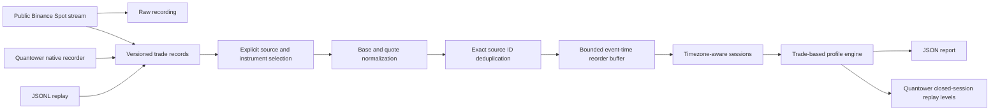

# Architecture

Core and Providers have no Quantower reference. Price and volume use decimal. Source identity includes venue, connection, market type and provider symbol. Mapping is explicit; same ticker alone is insufficient.

The first live CLI opens one public socket. Multi-source replay/custom baskets share the same engine. Native source supports one or two explicit Spot symbols but awaits real-DLL compilation. A shared bounded channel moves recording off callbacks. Each capture run owns independent immutable source mappings.

Recording preserves arrival order before deduplication. Replay uses that order to reproduce late-event decisions. Event-time ties use source identity then trade ID. Trades older than the two-second watermark are counted and excluded; correction/include modes are deferred. Completed-session levels are plotted only after the source session ends, never backwards into that session.

Exact deduplication retains IDs until completion/capacity. Default limits: one million IDs and 100,000 buffered events; exceeding either fails explicitly. All session profiles are retained in memory for a bounded dataset.

Overlapping native/external routes for the same physical feed are rejected. Native fallback IDs are flagged as unverified and cannot establish upstream deduplication.
